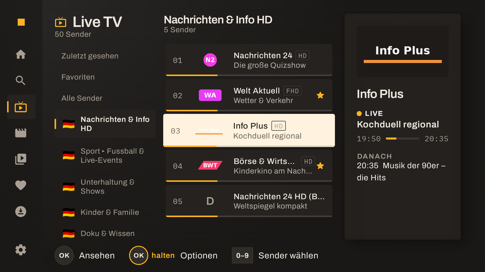
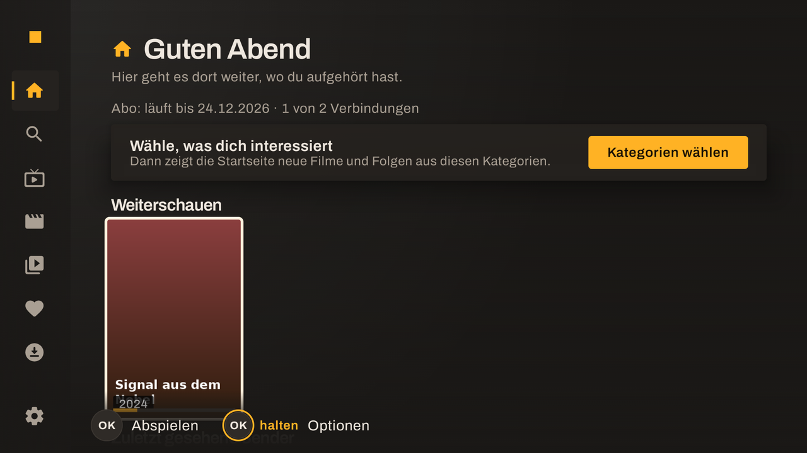
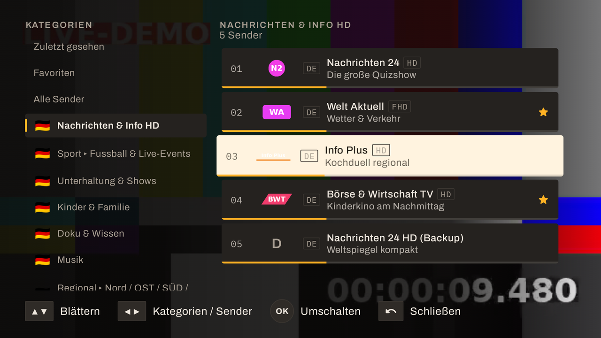
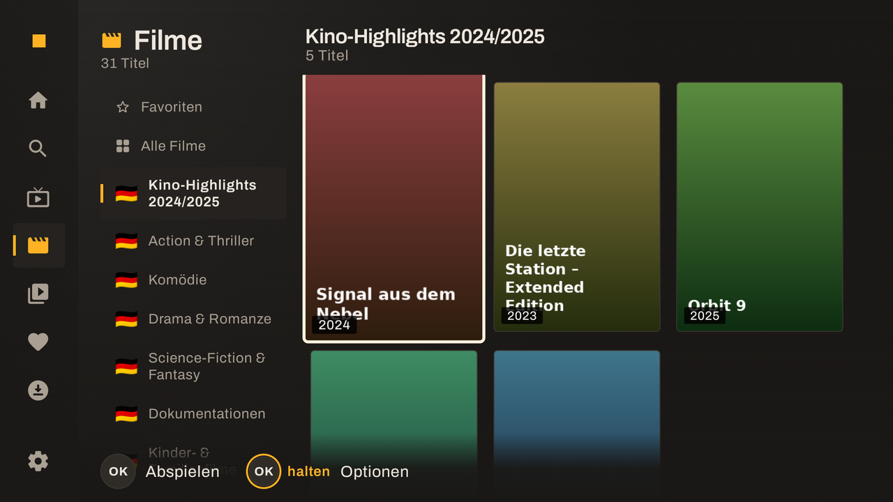
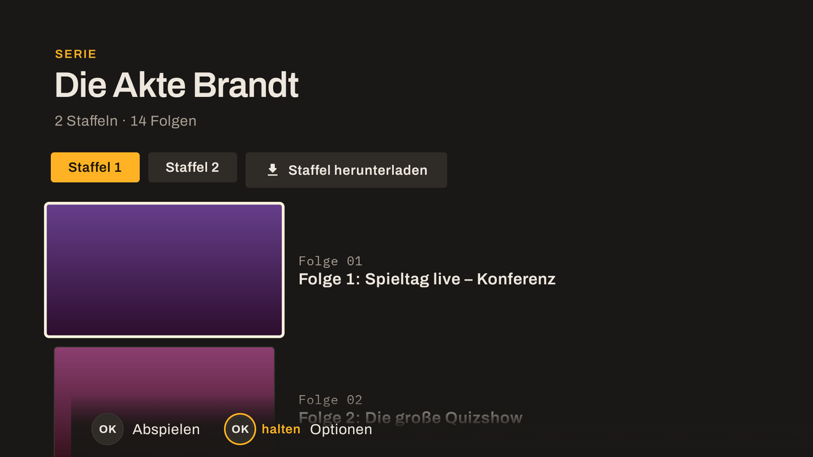
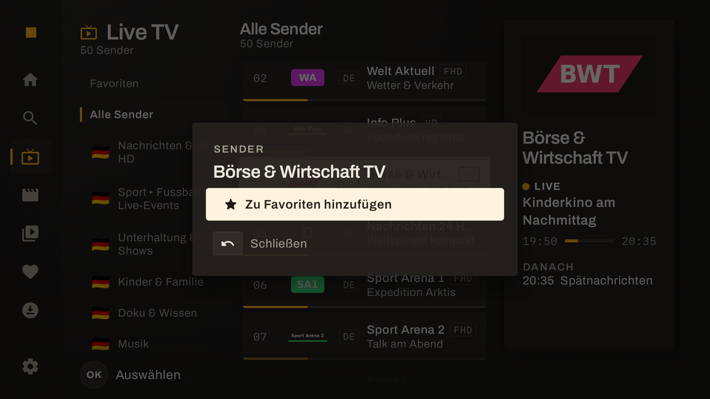
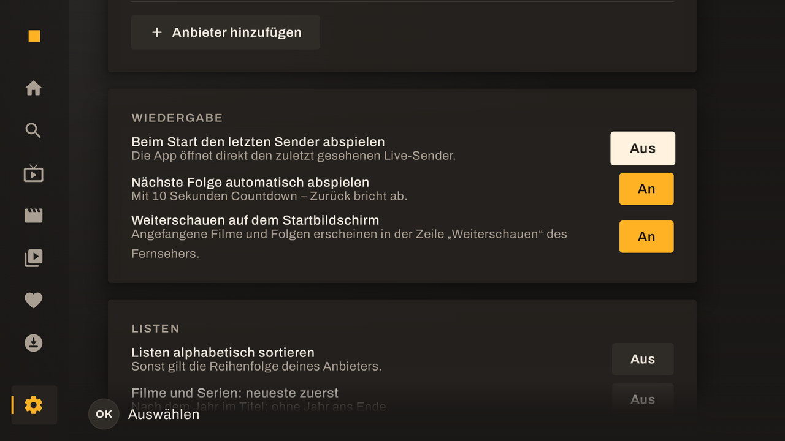

<div align="center">

# IPTV Player

**Ein schneller, aufgeräumter IPTV-Player für Fire TV, Android TV, Windows, Linux und (als Vorabversion) das iPhone –
gebaut für die Fernbedienung, ohne Werbung und ohne Tracking.**

[](https://github.com/vincentsberger/iptv-player/actions/workflows/ci.yml)
[](https://github.com/vincentsberger/iptv-player/releases/latest)
[](LICENSE)
-informational)




</div>

> **Hinweis:** Die App ist ein reiner Player und enthält **keine Sender, Playlists oder sonstigen Inhalte**.
> Du brauchst ein eigenes Abonnement bei einem Anbieter, der zur Verbreitung berechtigt ist.

## Inhalt

- [Funktionen](#funktionen)
- [Screenshots](#screenshots)
- [Installation](#installation)
- [Bedienung](#bedienung)
- [Datenschutz](#datenschutz)
- [Entwicklung](#entwicklung)
- [Releases](#releases)
- [Mitwirken](#mitwirken)
- [Lizenz](#lizenz)

## Funktionen

**Fernsehen**
- Anmeldung per **Xtream Codes** oder **M3U-Playlist** – bequem auch **per QR-Code vom Handy**
- **Live TV** mit Kategorien, Landesflaggen, „Jetzt/Danach“ und Sendungsfortschritt
- **Senderliste im Player:** durch Kategorien und Sender blättern, während das Bild weiterläuft
- Zappen mit ▲▼, Senderwahl per Zifferntasten, Taste für den letzten Sender
- **Verbindet sich selbst neu,** wenn der Stream abbricht oder hängt – Filme laufen an derselben Stelle weiter

**Filme und Serien**
- Filme und Serien mit Staffeln, **Weiterschauen** an der letzten Stelle, nächste Folge mit Countdown
- **Tonspur, Untertitel und Bildformat** wählbar – die Sprache gilt auch für den nächsten Film
- **Downloads für unterwegs:** Filme und ganze Staffeln laden und ohne Internet ansehen

**Komfort**
- **Startseite** mit Weiterschauen, **neuen Filmen und Folgen der letzten 7 Tage** aus selbst gewählten Kategorien,
  Abo-Laufzeit und Verbindungen, zuletzt gesehenen Sendern, Downloads und Favoriten
- **Schneller Start:** Sender, Filme und Serien werden zwischengespeichert und nur einmal am Tag neu geladen –
  danach zeigt eine **Übersicht**, ob alles vollständig da ist (Anzahl je Bereich, Veränderung, Warnung bei
  auffällig weniger Einträgen), mit „Neu laden“ und „Weiter“
- **Tastenleiste:** zeigt jederzeit, welche Taste der Fernbedienung was bewirkt; *OK halten* öffnet Optionen
- **Mehrere Anbieter** mit getrennten Favoriten und Verlauf, Suche über alle Bereiche
- **Länderfilter** für Live TV (z. B. nur DE/AT/CH), Schlaf-Timer, Kategorien ausblenden, A–Z-Sortierung, „endet um“-Anzeige, beschleunigtes Spulen
- **Updates direkt aus der App** (selbst installierte Versionen)

**Am PC (Windows/Linux)**
- Gleiche Daten und Logik, Oberfläche für Maus und Tastatur, Wiedergabe über VLC
- Live TV komplett per Tastatur, Ton-Verzögerung für Lippensynchronität

**Auf dem iPhone (Vorabversion)**
- Gleiche Daten und Logik mit Touch-Oberfläche: Live TV, Filme und Serien, Startseite, mehrere Anbieter
- Player mit Gesten: hoch/runter wischen zappt, vom linken Rand die Senderliste, Doppeltipp spult
- Hochformat mit Senderliste unter dem Bild, Querformat bildschirmfüllend; Wiedergabe über VLC

## Screenshots

| | |
|:--:|:--:|
| <br>**Startseite mit Abo-Laufzeit und Weiterschauen** | <br>**Senderliste im laufenden Player** |
| <br>**Filme nach Kategorien** | <br>**Serie mit Staffeln und Download** |
| <br>**Optionen per „OK halten“, z. B. als Favorit merken** | <br>**Einstellungen, u. a. Weiterschauen auf dem Startbildschirm** |

<sub>Alle Bilder zeigen den mitgelieferten [Demo-Server](tools/demo-server/README.md) mit erfundenen Sendern und Titeln.</sub>

## Installation

### Fire TV und Android TV

1. Am Fernseher die App **Downloader** installieren (im Amazon Appstore bzw. Google Play).
2. Dem Downloader erlauben, Apps zu installieren (*Einstellungen → Unbekannte Quellen*).
3. Im Downloader diese Kurzadresse eingeben – sie führt immer zur neuesten Version:

   ```
   is.gd/tvplayer1
   ```

   Ausgeschrieben: `https://github.com/vincentsberger/iptv-player/releases/latest/download/IPTV-Player.apk`

4. Installieren, öffnen, anmelden – am einfachsten über den QR-Code mit dem Handy.

Danach meldet sich die App selbst, wenn es eine neue Version gibt (*Einstellungen → App*).
Läuft auf allen Geräten mit Android 5.1 oder neuer, also Fire OS und Google TV; **nicht** auf Fire TV mit Vega OS.

### Linux (Debian/Ubuntu)

Paket `freeiptvplayer_*_amd64.deb` aus dem [neuesten Release](https://github.com/vincentsberger/iptv-player/releases/latest) laden, dann:

```bash
sudo apt install vlc ./freeiptvplayer_*_amd64.deb
```

### Windows

1. `FreeIPTVPlayer-*.msi` aus dem [neuesten Release](https://github.com/vincentsberger/iptv-player/releases/latest) laden und ausführen –
   die Wiedergabe-Engine (VLC) ist enthalten, eine eigene VLC-Installation ist nicht nötig.
2. Der Installer ist nicht signiert. Bei der SmartScreen-Warnung *Weitere Informationen → Trotzdem ausführen* wählen.

Selbst bauen: siehe [Entwicklung](#entwicklung) und [`docs/PUBLISHING.md`](docs/PUBLISHING.md) (MSI und Microsoft-Store-Paket).

### iPhone (Vorabversion)

`IPTV-Player-*.ipa` aus dem [neuesten Release](https://github.com/vincentsberger/iptv-player/releases/latest) ist
unsigniert und wird per Sideloading mit der eigenen, kostenlosen Apple-ID installiert (z. B. über SideStore, ohne Mac).
Schritt für Schritt: [`docs/IOS.md`](docs/IOS.md). Noch nicht dabei: Suche, Downloads, Ton-/Untertitelwahl.

## Bedienung

| Fernbedienung (TV) | Wirkung |
|---|---|
| **OK** | öffnen / abspielen – im Live-TV-Player: Senderliste |
| **OK halten** | Optionen: Favorit, Herunterladen, Kategorie ausblenden – im Player: Ton, Untertitel, Bildformat |
| **▲ ▼** | im Player: Sender bzw. Folge wechseln |
| **◀ ▶** | spulen (halten = größere Sprünge) |
| **0–9** | Sender per Nummer wählen |
| **Zurück** | zurück bzw. Menü schließen |

Nach dem Start erscheint die Übersicht der Playlist – **OK** auf „Weiter“ genügt. Was „neu“ auf der Startseite
zeigt, legst du unter *Einstellungen → Listen → Startseite* fest (Filme bzw. Serien wählen).

| Tastatur (PC) | Wirkung |
|---|---|
| **↑ ↓ / Enter** | Sender wählen / ansehen (Live TV) |
| **← →** | Kategorien ↔ Sender bzw. im Player spulen |
| **Strg + 1 … 7** | Bereich wechseln |
| **Leertaste · F · M · T** | Pause · Vollbild · Ton aus · Ton & Untertitel |
| **S · L · 0–9 · Esc** | Schlaf-Timer · letzter Sender · Senderwahl · zurück |

| Gesten (iPhone-Player) | Wirkung |
|---|---|
| **Tippen** | Bedienelemente ein/aus |
| **Hoch / runter wischen** | nächster / vorheriger Sender (Live) |
| **Vom linken Rand wischen** | Senderliste über dem Bild (Querformat) |
| **Doppeltipp links / rechts** | 10 s zurück / 30 s vor (Filme, Folgen) |
| **Lange drücken** (in Listen) | Favorit setzen/entfernen |

## Datenschutz

Zugangsdaten, Favoriten, Verlauf und die zwischengespeicherten Listen bleiben **ausschließlich auf deinem Gerät**
(am Windows-PC und auf Fire TV/Android TV ab Android 6 verschlüsselt, auf dem iPhone im Schlüsselbund) und gehen nur an den Server deines Anbieters. Keine Werbung, keine Analyse, kein Konto. Einzige weitere Verbindung: die abschaltbare,
tägliche Update-Abfrage bei GitHub. Details: [`DATENSCHUTZ.md`](DATENSCHUTZ.md).

## Entwicklung

Ein Projekt, drei Apps: Datenzugriff und App-Zustand sind **einmal** in Kotlin Multiplatform geschrieben,
nur die Oberflächen unterscheiden sich (Fernbedienung, Maus und Tastatur, Touch).

```
shared/        Gemeinsam: Xtream Codes, M3U, EPG, Favoriten, Verlauf, Suche, Navigation (AppState)
androidApp/    Fire TV / Android TV: Jetpack Compose for TV, Media3 (ExoPlayer), Downloads
desktopApp/    Windows / Linux: Compose Multiplatform, VLC (vlcj)
iosUi/         iPhone-Oberfläche: Compose Multiplatform – kompiliert auch unter Linux
iosApp/        iPhone-App: Einstieg, MobileVLCKit, Xcode-Projekt (XcodeGen) – baut nur auf macOS bzw. in der CI
testing/       Attrappen für HTTP und Speicher, Beispieldaten für Tests
tools/         Demo-Server, Release-Skripte
```

**Voraussetzungen:** JDK 17 (installiert; der Gradle-Daemon nutzt es automatisch über
`gradle/gradle-daemon-jvm.properties`, auch wenn das System-Java neuer ist), Android SDK, für die PC-App VLC
(installiert, oder unter Windows mitgeliefert per `tools/fetch-vlc.sh`).
Am einfachsten mit Android Studio: Projektordner öffnen, Konfiguration *androidApp* bzw. *desktopApp* starten.

```bash
./gradlew :androidApp:installDebug     # TV-App auf Emulator oder Gerät (adb connect <IP>)
./gradlew :desktopApp:run              # PC-App
```

**Tests** laufen ohne Netzwerk:

| Bereich | Befehl |
|---|---|
| Gemeinsame Logik | `./gradlew :shared:desktopTest` |
| PC-Oberfläche | `./gradlew :desktopApp:test` |
| iPhone-Oberfläche (nur Kompilieren) | `./gradlew :iosUi:compileKotlinIosArm64` |
| TV-Oberfläche inkl. Fernbedienung | `./gradlew :androidApp:connectedDebugAndroidTest` (Emulator oder Gerät nötig) |
| Statische Analyse (alle Module) | `./gradlew detekt` – Altbefunde in `config/detekt/baseline.xml`, neu einfrieren mit `./gradlew detektBaseline` |

Die CI führt die Logik- und PC-Tests in Pull Requests unter **Linux** und auf `master` zusätzlich unter **Windows**
aus; reine Doku- und iPhone-Änderungen lösen sie nicht aus. Die iPhone-App baut der Workflow `iOS` (macOS) in Pull
Requests und auf `master`, inklusive der Logik-Tests auf dem iOS-Simulator. Ein Fenstertest prüft in der CI,
dass das Vollbild ohne Titelleiste den Bildschirm füllt; lokal läuft er nur mit `CI=1`, weil er ein echtes
Fenster öffnet.

Zum Ausprobieren ohne echten Anbieter gibt es einen [Demo-Server](tools/demo-server/README.md) mit erfundenen
Sendern, Filmen, Serien und Testvideos mit mehreren Ton- und Untertitelspuren.

## Releases

Ein Release entsteht automatisch, sobald ein Versions-Tag gepusht wird:

```bash
# appVersion in gradle.properties anheben und committen, dann:
git tag v1.4.0 && git push origin v1.4.0
```

Der Workflow [`release.yml`](.github/workflows/release.yml) prüft Tag und Version und stellt sicher, dass die CI
(Linux und Windows) für genau diesen Commit grün ist – war sie es auf `master` schon, wird sie nicht wiederholt.
Danach baut er die signierte APK (der Schlüssel liegt nur in den Repository-Secrets), das Linux-Paket, den
Windows-Installer und die unsignierte iPhone-`.ipa` und veröffentlicht das Release.

**Nur Geändertes wird neu gebaut.** [`tools/release/plan-platforms.sh`](tools/release/plan-platforms.sh) vergleicht
mit dem vorigen Tag: Änderungen nur in `iosApp/`/`iosUi/` bauen nur die `.ipa`, nur in `desktopApp/` nur `.deb` und
`.msi`, nur in `androidApp/` nur die APK; `shared/` und Build-Dateien bauen alles. Unveränderte Dateien übernimmt das
Release aus dem vorigen – mit ihrer alten Version im Namen (`IPTV-Player-1.7.0.apk` in Release 1.8.0). TV- und PC-App
lesen ihre Version aus diesem Namen und melden deshalb kein Update, wenn sich für sie nichts geändert hat. Die
Release-Notizen nennen, was neu gebaut und was übernommen wurde. Scheitert nur der iPhone-Bau, bleibt die `.ipa` des
vorigen Releases. Von Hand (z. B. alles neu bauen): *Actions → Release → Run workflow*, den Tag wählen und bei
„platforms“ `all` oder z. B. `android ios` eintragen. Vorab prüfen: `tools/release/plan-platforms.sh v1.8.0`.

Auch die CI trennt: [`ci.yml`](.github/workflows/ci.yml) testet die PC-App nur bei Änderungen an `desktopApp/` oder
`shared/`, die TV-App nur bei `androidApp/` oder `shared/`; die iPhone-App hat ihren eigenen Workflow
([`ios.yml`](.github/workflows/ios.yml)).
Store-Pakete und Store-Einreichungen beschreibt [`docs/PUBLISHING.md`](docs/PUBLISHING.md).

## Mitwirken

Fehler und Wünsche gerne als [Issue](https://github.com/vincentsberger/iptv-player/issues).
Pull Requests sind willkommen – bitte mit Tests für neue Logik in `shared/` und ohne Inhalte, Playlists,
Zugangsdaten oder Logos bekannter Sender.

## Lizenz

[GNU General Public License v3.0](LICENSE). Wer den Code weitergibt oder verändert veröffentlicht,
muss den Quellcode unter derselben Lizenz offenlegen.
